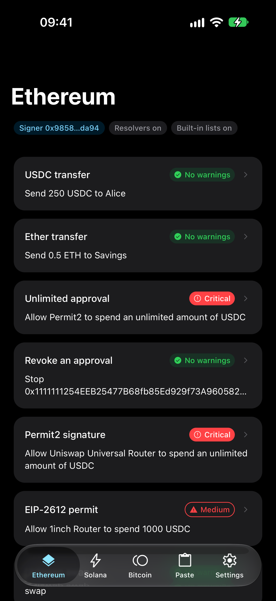
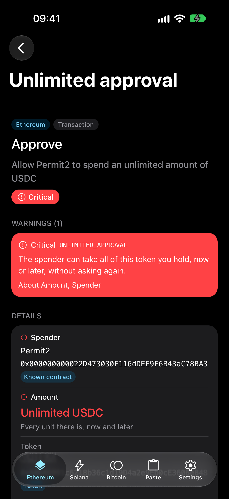
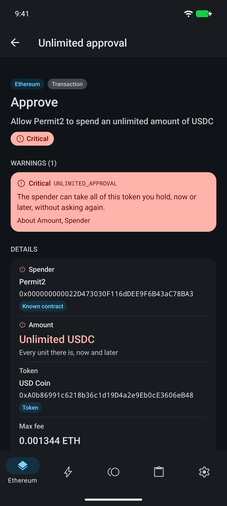

# crypto-clear-sign

[](https://www.npmjs.com/package/@hzblj/crypto-clear-sign)
[](./LICENSE)

Clear signing for React Native and Expo, as data. Before a wallet signs an Ethereum transaction, EIP-712 typed data,
a Solana transaction or a Bitcoin PSBT, it shows what the signature does: "Allow Uniswap to spend an unlimited amount
of USDC", marked critical, instead of "call data 0x095ea7b3…". The chain packages read what is about to be signed
through [`@hzblj/nitro-crypto`](https://github.com/hzblj/nitro-crypto)'s adapters into one display model (an intent,
fields, nested actions, warnings with stable codes, a risk level), and every UI renders that model. Headless: no UI,
no network.

<!-- Screenshots of the example, to be added: uncomment once media/ has them.
<p>
  
  
  
</p>
-->

| Package | What it is |
| --- | --- |
| [`@hzblj/crypto-clear-sign`](./packages/crypto-clear-sign/README.md) | The display model every chain package returns and every UI renders, its helpers (exact amounts, translations, plain text), the shared warning codes, and the resolver interfaces. No dependencies; installs alone. |
| [`@hzblj/crypto-clear-sign-ethereum`](./packages/crypto-clear-sign-ethereum/README.md) | Transactions of every type, EIP-712 typed data, personal messages with Sign-In with Ethereum, and EIP-7702 authorizations; built-in decoders for the standard calls, ERC-7730 descriptors, and a bundled set from the registry. |
| [`@hzblj/crypto-clear-sign-solana`](./packages/crypto-clear-sign-solana/README.md) | Legacy and v0 transactions, messages and off-chain messages; IDLs. |
| [`@hzblj/crypto-clear-sign-bitcoin`](./packages/crypto-clear-sign-bitcoin/README.md) | PSBTs (P2WPKH and Taproot), with runestones and the inscriptions and runes of the signer's coins; messages (BIP-322, legacy, CAIP-122 sign-in). |

```sh
npx expo install @hzblj/crypto-clear-sign @hzblj/crypto-clear-sign-ethereum @hzblj/crypto-ethereum @hzblj/nitro-crypto react-native-nitro-modules
```

```ts
import {localize, plainText} from '@hzblj/crypto-clear-sign'
import {clearSignTransaction} from '@hzblj/crypto-clear-sign-ethereum'

const result = await clearSignTransaction(crypto.chains.ethereum, unsigned, {resolvers, signer: account.address})
result.intent.text // 'Approve'
result.summary?.text // 'Allow Uniswap to spend an unlimited amount of USDC'
result.risk // 'critical'
result.warnings.map(warning => warning.code) // ['UNLIMITED_APPROVAL']
plainText(result) // the whole review as text, for screen readers and logs
```

Resolvers are how an app adds what the bytes do not say (token symbols, names and the address book, ERC-7730
descriptors and IDLs, the clock). None is required, and each is a trust boundary: what it answers is shown as fact.
[SECURITY.md](./SECURITY.md) says what clear signing protects and what it cannot (decoding is not simulation, and a
descriptor can lie).

## The example

`apps/example` is an Expo app (built with [`@hzblj/kara-ui`](https://www.kara.janblazej.dev)) that reviews real-world
signing requests through the packages, on Ethereum, Solana and Bitcoin main networks. Nothing is signed or broadcast:
each request is built in the app from the adapters, read by its chain package and shown.

- **Ethereum, Solana, Bitcoin**: a gallery per chain, each request with its risk. USDC and ether transfers, an
  unlimited approval and a revoke, Permit2 and EIP-2612 permits, a Uniswap swap read by the bundled ERC-7730 registry,
  `setApprovalForAll`, a Seaport order nothing reads, Sign-In with Ethereum for the right site and for another, EIP-7702
  delegations (one for every chain), a blind message; SOL and SPL transfers, a v0 swap with lookup tables, a
  `setAuthority` drainer, `closeAccount` to a stranger, a durable nonce, Sign In With Solana, an off-chain message, an
  unknown program with and without its Anchor IDL; a payment with change, a consolidation, a high fee, SIGHASH_NONE
  and SINGLE|ANYONECANPAY, a runestone and a cenotaph, an inscription spent as fee, a BIP-322 message.
- **A review** is one component, `ClearSigningView`, that renders any `ClearSigning` from the model alone: the intent
  and summary, the risk, the warnings by severity with the fields they point at, every field by its kind, the actions
  as a tree, how each was understood, the raw remainder and the `plainText`. Its parts (`RiskBadge`, `WarningList`,
  `FieldRow`, `ActionTree`, `SourceLine`, `RawSection`) are in `apps/example/src/components/clear-signing`, written to
  be copied into a wallet.
- **Paste**: any transaction, typed data, message, authorization or PSBT as hex, Base64, JSON or text, reviewed the
  same way; what does not read comes back as its `ClearSignError` code.
- **Settings**: the signer on each chain (so `self` means something, and a sign-in for another account shows why it
  matters), the app's resolvers and the packages' built-in lists on or off (offline against resolved), and Czech
  through `localize`, by the same stable codes.

Its Node tests run every sample through the four packages and assert each one's risk and warning codes, resolved and
offline: an integration test of the whole repository.

## This repository

| Path | What lives there |
| --- | --- |
| `packages/crypto-clear-sign/`, `crypto-clear-sign-ethereum/`, `-solana/`, `-bitcoin/` | The packages, each published on its own |
| `apps/example/` | The example app (private): galleries per chain, Paste, Settings |
| `scripts/` | The pack check, version sync |
| `docs/` | [The chain package contract](./docs/chain-package-contract.md), [compatibility](./docs/compatibility.md), [decisions](./docs/adr) |

```sh
yarn                 # install
yarn test            # every package's tests (the chain packages on the engine compiled to WebAssembly)
yarn typecheck       # tsc
yarn lint            # Biome and tsc, per package
yarn pack:check      # what npm receives, and each package's consumer type-checked against it
yarn ios             # the example on the iOS simulator (yarn android for Android)
```

## More libraries

The other libraries from the same author are at **[libraries.janblazej.dev](https://www.libraries.janblazej.dev)**.

[Security](./SECURITY.md) · [MIT](./LICENSE)
